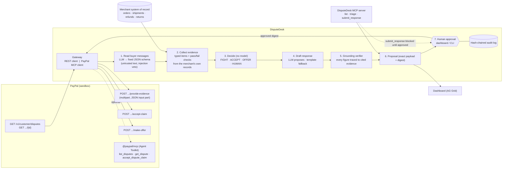

# Architecture

DisputeDesk is a pipeline in which **models propose and deterministic code decides**. PayPal is on both ends of it: it is where the disputes come from and where the response lands.

## Components

| Path | Role |
|---|---|
| `src/paypal/rest.js` | Disputes v1 REST client: OAuth2 client-credentials, list, get, provide-evidence (multipart), accept-claim, make-offer, 401 token refresh, call log |
| `src/paypal/mcp-gateway.js` | Spawns **PayPal's own MCP server** (`@paypal/mcp`) over stdio and calls `list_disputes`, `get_dispute`, `accept_dispute_claim`. Evidence/offer fall back to REST because the toolkit has no such tools |
| `src/paypal/mock-server.js` | Local **PayPal sandbox simulator** used by DEMO mode so the real client code runs without credentials. Request/response shapes follow PayPal's OpenAPI spec. It is not PayPal |
| `src/merchant/store.js` | The shop's system of record (JSON in demo; implement `byTransaction()` for Shopify/Woo/your DB) |
| `src/engine/messages.js` | Buyer-message signals. LLM answers a fixed schema; regex heuristic is both the offline path and an injection veto |
| `src/engine/triage.js` | Evidence items + checks, the decision rules and the rule trace shown in the UI |
| `src/engine/narrative.js` | Template draft (always available) + optional LLM draft |
| `src/engine/verify.js` | The grounding gate |
| `src/engine/agent.js` | Orchestration, proposals, approval, submit (digest-bound) |
| `src/engine/state.js` | File-backed proposals + SHA-256 hash-chained audit log, shared by dashboard, CLI and MCP |
| `src/mcp/server.js` | DisputeDesk as an MCP server for any MCP client |
| `src/web/*` | Dashboard: AG Grid Community queue, case detail, approval bar, API-call/audit/benchmark drawer |

## The decision rules (all in `src/engine/triage.js`)

| Dispute reason | Fight when… | Accept when… | Other |
|---|---|---|---|
| Item not received / Unauthorised | Carrier status DELIVERED, delivered to the transaction's postal code + country, dates consistent, (signature on file above USD 750), amount ≥ threshold | No shipment on record; delivered elsewhere | In transit, missing signature, "I moved" claim, or dates inconsistent → human |
| Not as described | Buyer concedes the item is fine (change of mind) | – | Damage → offer full refund (your own policy); unclear → human. PayPal's Seller Protection excludes SNAD, so this is judgement, not proof |
| Credit not processed | Completed refunds cover the disputed amount (refund IDs are the proof) | Return received, no refund | Partial refund → offer the remainder; nothing on record → human |
| Duplicate transaction | A second genuine, shipped order exists for the same amount | One order only | – |
| Anything else / window closed / no matching order | – | – | Human |

Economics: a winnable dispute below `MIN_FIGHT_AMOUNT` (default USD 10) is accepted; it is not worth the attention.

## Safety design

1. **No model decides.** The LLM reads text into booleans and drafts prose. Rules decide the action.
2. **Untrusted text is data.** Buyer messages only reach the model inside a delimited block with a fixed output schema. Nothing from them reaches a rule, a payload or the draft. A deterministic injection regex can veto a model that missed an attack; on a detected injection a contest is never proposed automatically (it goes to a human), because an attacker could be trying to suppress a signal such as "I moved".
3. **Grounding gate.** A drafted response is accepted only if each sentence cites existing evidence items and every date, amount, ID, tracking number and plain number appears in the cited evidence; sensitive claim words (signed, photo, insured, delivered, refund …) only appear when the cited evidence says so. On rejection the template is used and the rejection is shown in the UI.
4. **Human approval, bound to a digest.** `submit()` refuses anything not approved, and anything whose payload changed after approval. The MCP `submit_response` tool is subject to the same gate: an agent cannot approve its own proposal.
5. **Audit.** Every triage, approval, rejection and submission is appended to a SHA-256 hash-chained log; tampering is detected (`/api/audit`, `audit_log` tool).
6. **Fails closed.** Unknown reason, missing merchant record, closed deadline, failed verification → human review or no action.

## What the verifier cannot catch (known limits)

- It is lexical: a sentence can reuse correct numbers in a misleading way (e.g. attributing the right date to the wrong event). Template sentences avoid this; LLM sentences are limited by the closed fact list in the prompt but not proven semantically.
- It does not read attached documents; DisputeDesk currently submits notes + tracking/refund IDs only (no PDF/photo upload).
- Evidence quality depends on the merchant's records being truthful; the agent cannot detect a falsified shipping record.
- The strength percentage is a checklist coverage score, not a probability of winning.
- Not covered: chargebacks at the card-network level, `provide-supporting-info`, `escalate`, `appeal`, `acknowledge-return-item`, webhooks, document upload.
